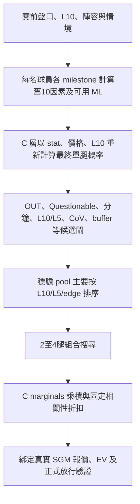

# NBA 選腿、進階數據與跨場 Multi 審計

日期：2026-10-25。基準：0ac88e6374db43692d851b0a4d665ddb4ba192f1。
本輪不改正式 C 概率、selector、EV 門檻或投注注碼。工程修正不是已證明準確率／盈利改善。

## 實際流程

依據：generate_nba_reports.py 的 build_player_card、banker_pool、select_combo_1、compute_combo_ev。C 不是在 L10 選完後才檢查，亦不是包含全部進階數據的防守模型。C 公式只直接輸入 stat、價格和 L10；舊10因素與 ML 概率在 C 啟用時被取代。MC 及部分情境守則另有路徑，不能因此宣稱所有防守資訊已進 C。

合成接線測試：同價／L10，只改 B2B、home、pace、defensive rank、spread，舊10因素98→96，C57.1→57.1。這是程式接線證據，不是預測表現比較。舊 playoff guard 與 public season_phase／strategy_phase 的兼容性仍需另行驗證。

## 進階數據應如何使用

| 類別 | 適合研究的選腿信息 | 限制 |
|---|---|---|
| 得分 | USG%、分鐘、出手／罰球機會、對手失分、DEF_RATING、pace | USG 高不保證命中；市場可能已定價 |
| 助攻 | 持球時間、potential assists、AST%、隊友投射／傷停、對手容許助攻 | 不以「射手」稱號判斷；角色與轉隊需分開 |
| 籃板 | rebound chances、攻防籃板、對手容許籃板、投失球量、預計分鐘 | 對手自己搶籃板不等於容許對手搶籃板 |
| 賽程／對位 | B2B、休息、對同對手歷史、實際可上陣防守者 | H2H 小樣本、舊隊／舊教練；團隊排名不是實際盯防 |

新 collector 保存 NBA Opponent 的 OPP_PTS／REB／AST／OREB／DREB／FGA／FGM，各自 per_game 和 per_100_possessions、GP、season、regular-season 類別與 history_date_to。缺值留 null；模式失敗／球隊缺列／不足資料明列。這些是描述欄位，model_input_enabled=false，不加分或改 C。抽取入口已接入 team_stats；mock/source-contract 驗證不代表實際聯盟覆蓋已確認。下一次正常抽取需核對實際返回列及數值健康，再收集不可變賽前快照。

八場舊快照可用的32個球員場次全部有 USG／AST%，但全部只有最多2場同季 regular-season 樣本。原 team_dvp 只含 Overall D_FG_PCT／PCT_PLUSMINUS，並非按位置／stat 的容許助攻或籃板。不能將舊欄位名稱當成已取得這些資料。

## 已修正的防守名單問題

舊歷史排名沒有先核對當前 roster／Out。新流程先保留完整 reference，再用已驗證 roster 及已知傷停篩選，最後取最多8人。未驗證 roster 不輸出可用名單；Questionable 不等於確認 Out。保留排除原因、來源數及 actual_matchups_verified=false；刷新後傷癒者可恢復，來源不被不可逆刪除。

同8份凍結快照 A/B：原 top-three47列，有24列不在當時 roster、4列已知不可上陣（可重疊）；修後37列，上述兩項均0。players／injuries／usage／team_stats／team_dvp／odds 不變，1,471個 C 概率逐個重現相同。這是資料正確性修正，沒有命中率或 ROI 結論。原快照 top8 之前已截斷，不能事後恢復未保存的其他防守者。

## ML 與驗證次序

C 本身是小型 logistic 模型。現有27-feature RandomForest 本機模型 legacy-unverified、deployment_eligible=false；hybrid ML 調整預設關閉。EXP-20261023-06 的重建 RF 在已用比較窗 Brier .182219，C .171071；差值+.011148，區間[+.001562,+.019958]。該 C 比較有歷史重疊，不能當乾淨 holdout；也不支持採用 RF。

下一步先收 PIT 角色／opportunity／opponent 資料，檢查分鐘、轉隊、樣本數及截止時間。逐項比較 C baseline 與 C+context，時間分組、逐項 ablation、校準與實價 ROI 並報；未過既有證據要求前只 shadow。不能用今日 Herro 差一助攻去調參，亦不能為提高命中而隱藏負 EV。

## 跨場可行性

Sportsbet 普通 Multi 可跨場；SGM 限同一場，SGM+ 組合多張 SGM。現有報告的 Top Banker Legs 不是已綁報價的跨場投注單。

固定舊8場賽前 quote／market leg 集合，最多2張，每張2–4腿、不同場次／球員、兩張不共用場次，參考乘積價2–3.5。固定規則不讀賽果。

- M0：單腿及組合保留非負／正 EV，0張。
- M1：移除 EV 閘作研究，有2張；參考乘積價2.03及2.05556，獨立假設 joint .465716／.451451472，參考 EV −5.46%／−7.20%。

不是 Sportsbet 實際 Multi 報價或當前建議；未核實相容性、聯合價格、跨場誤差相關，不能投注／算正式ROI。結果說明結構上可組合，沒有證明跨場可解決盈利問題。下一階段才接原生報價、最早開賽前 freshness 及獨立 forward。

## 證據及交付界線

證據根：`/Users/imac/WongChoiData/NBA_Research/2026-10-25-selection-flow-and-daily-multi/`。
Frozen_Protocol.md、Prerun.json、Replay_Daily_Multi.py、Feasibility.json、Routing_Check.json、Advanced_Data_Readiness.json、Defender_Roster_AB.json。結果已見的可行性回放不叫 blind，不用 outcomes 選腿、不計 ROI。正式模型與 Dashboard 推薦未切換。

顯示慣例採總數在前：6中5、17中15。之前 A0／A1 六場結果為6中4／6中5，不能與不同 final_refresh 報價混算。

來源：[Sportsbet Multi／SGM](https://helpcentre.sportsbet.com.au/hc/en-us/articles/115006804868-Single-Multi-Same-Game-Multi-Basics)、[SGM+](https://helpcentre.sportsbet.com.au/hc/en-us/articles/18717114634893-Can-I-Add-Multiple-Same-Game-Multi-s-Into-One-Multi)。
